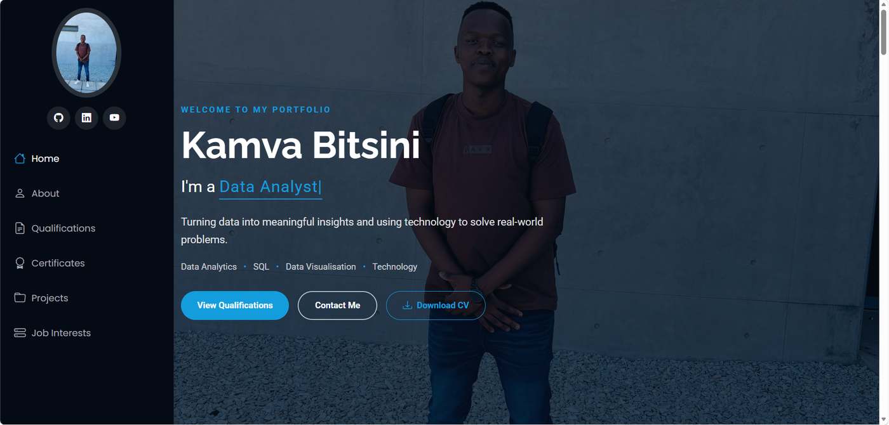
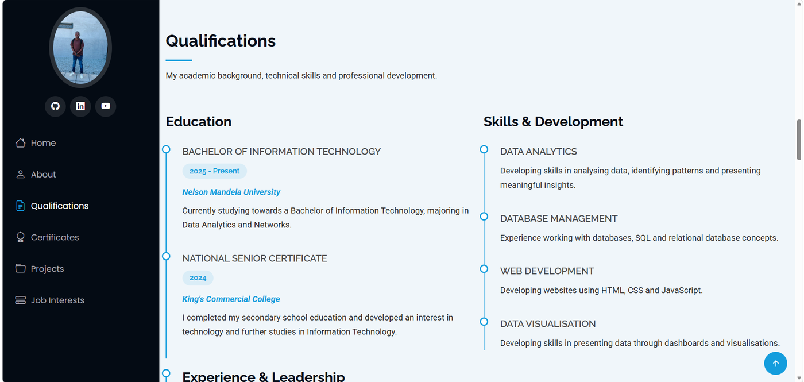
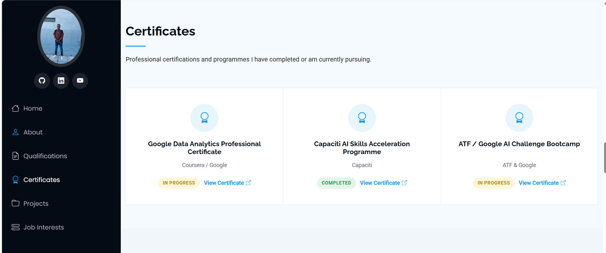
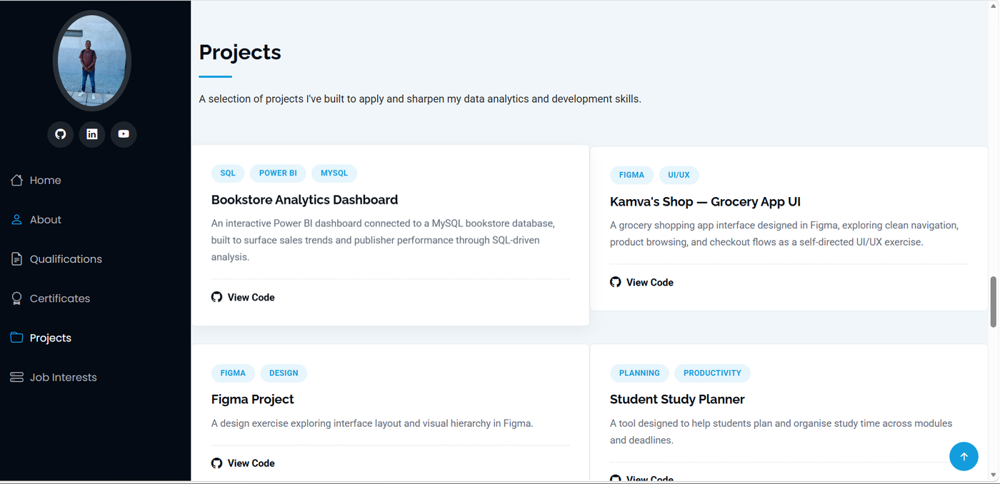
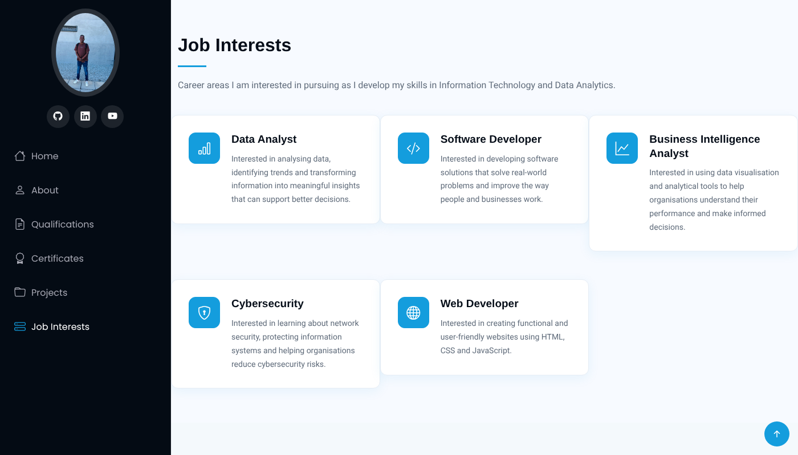

# Kamva Bitsini | Personal Portfolio Website

A responsive, single-page portfolio website for **Kamva Bitsini**, a second-year Bachelor of Information Technology student (Data Analytics major) at Nelson Mandela University, Gqeberha, South Africa.

It was built for the IWDV202 (Web Development) module and customised well beyond the starting template: new sections, project and certificate cards, a CV download, a working contact form and an animated hero.

**Live site:** https://kamva204.github.io/kamva-portfolio-website/



## Sections

| Section | What it shows |
|---|---|
| **Home** | Landing hero with background image, typed-text job title, and quick links (View Qualifications, Contact Me, Download CV) |
| **About** | Short bio, degree, location and availability for freelance work |
| **Skills** | Animated skill bars for the tools I use |
| **Qualifications** | Education timeline, skills and development, and campus leadership roles (Peer Helper, Examination Invigilator) |
| **Certificates** | Google Data Analytics (in progress), Capaciti AI Skills Acceleration (completed), ATF / Google AI Challenge Bootcamp (in progress) |
| **Projects** | Bookstore Analytics Dashboard, Kamva's Shop grocery app UI, Figma Project, Student Study Planner, each linked to its GitHub repo |
| **Job Interests** | Data Analyst, Software Developer, BI Analyst, Cybersecurity, Web Developer |
| **Contact** | Contact form (Formspree), map and social links |

## Screenshots

| Qualifications | Certificates |
|---|---|
|  |  |

| Projects | Job Interests |
|---|---|
|  |  |

## Tech Stack

- **HTML5, CSS3, JavaScript**
- **Bootstrap 5** and **Bootstrap Icons**
- **AOS** (scroll animations), **Typed.js** (hero text), **GLightbox**, **Swiper**, **Isotope**
- **Formspree** for the contact form (no backend needed)
- **Google Maps embed** and **Google Fonts** (Raleway, Poppins, Roboto)

## Run Locally

No build step is needed.

```bash
git clone https://github.com/kamva204/kamva-portfolio-website.git
cd kamva-portfolio-website
```

Then open `index.html` in your browser, or use the **Live Server** extension in VS Code.

## Project Structure

```
kamva-portfolio-website/
├── index.html
├── assets/
│   ├── css/main.css
│   ├── js/main.js
│   ├── img/            # hero and profile image
│   ├── cv/             # downloadable CV
│   ├── certificates/   # certificate PDFs
│   └── vendor/         # third-party libraries
└── screenshots/
```

## What I Changed From the Template

- Rebuilt the content and structure around a personal data-analytics portfolio
- Added **Certificates** and **Projects** sections with status badges and GitHub links
- Added an animated typed-text hero with a **Download CV** button
- Connected the contact form to Formspree and embedded a location map
- Restyled the colours, cards and timeline layout

## Credits

Template: [iPortfolio](https://bootstrapmade.com/iportfolio-bootstrap-portfolio-websites-template/) by [BootstrapMade](https://bootstrapmade.com/), used under the [BootstrapMade license](https://bootstrapmade.com/license/).

## Connect With Me

- GitHub: [@kamva204](https://github.com/kamva204)
- LinkedIn: [Kamva Bitsini](https://www.linkedin.com/in/kamva-bitsini-a30362411)
- YouTube: [@KamvaTech](https://www.youtube.com/@KamvaTech)
